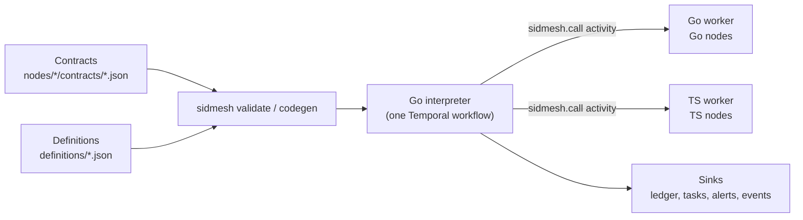

# SidMesh

Build a system out of small nodes with explicit contracts. Nodes own capabilities, each
described by a JSON contract; JSON definitions wire capabilities into workflows that a single
Go interpreter runs durably on [Temporal](https://temporal.io).

**Status:** internal, pre-1.0 (spec v0.3). Used by one internal project. Every minor
release may break; read the [changelog](CHANGELOG.md) before upgrading.

## Why

Workflows that cross systems fail in the same few ways: a write runs twice, a timeout hides
whether it happened, an AI decision goes through unchecked, nobody can say which version of
the flow a run used. SidMesh puts those rules in the contract and the engine instead of in
every workflow:

- **Contracts, not conventions.** Every capability declares its input, config, the outcomes
  it can finish with and their output, and whether it writes. Both runtimes validate every
  call against it.
- **Safe writes.** A write capability declares an idempotency key and a read-only lookup.
  When a write fails ambiguously, the engine asks the lookup before retrying, and routes
  `unknown` when it cannot tell.
- **AI with a gate, people in the loop.** An `ai` capability returns a confidence; below the
  step's threshold the workflow goes to a human task instead.
- **Every run is pinned.** A run records the content hash of every document it uses;
  editing a definition never changes a run in flight.
- **An audit trail by default.** Ledger, task, alert and event records for every step, to
  JSON lines or Postgres.

**Use it when** a process spans several systems or teams, needs durable waits (hours to
weeks), human review or AI decisions with a fallback, and an answer to "what happened in this
run". **Don't use it** for a single service's internal jobs, for data-heavy transformations
(those belong inside a node), or for a flow that changes shape at run time.

## How it works



1. You write contracts for each node and definitions that wire them, then run
   `sidmesh validate` (every rule in the spec) and `sidmesh codegen` (typed handlers).
2. A client starts a definition. The start pins the definition and everything it can reach
   by content hash.
3. The interpreter walks the step graph: `call`, `decide`, `set`, `wait`, `human`, `spawn`,
   `signal`, `compensate`, `end`.
4. Each `call` runs as one Temporal activity on the task queue of the node's runtime, Go or
   TypeScript. The runtime validates the input before the handler and the outcome after it.
5. Records go to the sinks; payloads in Temporal can be encrypted end to end.

## Example

A contract (`nodes/greeter/contracts/greet.v1.json`):

```json
{
  "capability": "greeter.greet",
  "version": 1,
  "kind": "action",
  "effects": "none",
  "summary": "Greet someone by name.",
  "input": {
    "type": "object",
    "properties": { "name": { "type": "string", "minLength": 1 } },
    "required": ["name"],
    "additionalProperties": false
  },
  "outcomes": {
    "greeted": {
      "description": "A greeting was written.",
      "output": { "type": "object", "properties": { "message": { "type": "string" } },
                  "required": ["message"], "additionalProperties": false }
    },
    "refused": {
      "description": "The name is on the refuse list.",
      "output": { "type": "object", "properties": { "reason": { "type": "string" } },
                  "required": ["reason"], "additionalProperties": false }
    }
  }
}
```

A definition that calls it and routes every outcome (`definitions/hello.v1.json`):

```json
{
  "id": "hello",
  "version": 1,
  "description": "Greet someone; fail when the name is refused.",
  "input": { "type": "object", "properties": { "name": { "type": "string" } },
             "required": ["name"], "additionalProperties": false },
  "start": "greet",
  "steps": {
    "greet": {
      "type": "call", "capability": "greeter.greet", "version": 1,
      "input": { "name": "input.name" },
      "on": { "greeted": "done", "refused": "refused", "failed": "failed" }
    },
    "done":    { "type": "end", "status": "completed", "output": { "message": "steps.greet.output.message" } },
    "refused": { "type": "end", "status": "failed" },
    "failed":  { "type": "end", "status": "failed" }
  }
}
```

The handler (`nodes/greeter/index.ts`), typed from the contract by `sidmesh codegen`:

```ts
export const handlers: Handlers = {
  "greet@1": async (input) =>
    input.name === "Mallory"
      ? { outcome: "refused", output: { reason: "on the refuse list" } }
      : { outcome: "greeted", output: { message: `Hello, ${input.name}` } },
};
```

The full project is [`ts/examples/e2e`](ts/examples/e2e). A larger one, with an AI gate, a
human review, child workflows and a write with its lookup, is
[`go/examples/demo`](go/examples/demo).

## Concepts

| Term | Meaning |
| --- | --- |
| **Node** | A unit of ownership (`nodes/<id>/node.json`). It owns capabilities and runs on one runtime, `go` or `ts`. |
| **Capability** | Something a node can do, named `<node>.<verb>`, versioned (`@1`, `@2`). |
| **Contract** | The JSON document of one capability version: input, config, outcomes, effects, idempotency, lookup. |
| **Definition** | A workflow: a graph of steps over capabilities, with params, vars and signals. |
| **Binding** | How a step reads data: a path (`steps.greet.output.message`), a constant, or a CEL expression. |
| **Interpreter** | The one Go Temporal workflow that runs every definition. |
| **Pins** | Content hashes of the documents a run uses, recorded at start. |
| **Sinks** | Where ledger, task, alert and event records go (JSON lines or Postgres). |

## Quickstart

Needs Go 1.25, Node 22+ with pnpm, and the [Temporal CLI](https://docs.temporal.io/cli).

```bash
temporal server start-dev                                   # terminal 1
cd go && go build -o bin/ ./cmd/sidmesh-run ./examples/demo/worker
cd ../ts && pnpm install && pnpm build
SIDMESH_BIN=../go/bin examples/e2e/run.sh                   # starts both workers, runs `hello` twice
```

To start your own project: create `sidmesh.json` (`{"name": "my-project", "spec": "0.3"}`),
scaffold a node with `sidmesh new-node <id> --runtime go|ts`, write a definition, then
`sidmesh validate` and `sidmesh codegen`.

## Use it in a project

The repository is private: give the machine read access (`gh auth login`, then git uses
`gh auth git-credential`) and tell Go to fetch it directly.

```bash
export GOPRIVATE='github.com/junixlabs/*'
go get github.com/junixlabs/sidmesh/go@latest
```

```json
{ "dependencies": { "@sidmesh/core": "github:junixlabs/sidmesh#semver:>=0.3.1&path:/ts" } }
```

`@sidmesh/core` builds itself on install, so pnpm must allow it:
`allowBuilds: { "@sidmesh/core@git+https://github.com/junixlabs/sidmesh.git": true }` in
`pnpm-workspace.yaml`. Internal tools track the newest release: run
`go get github.com/junixlabs/sidmesh/go@latest && pnpm update @sidmesh/core`, read the release's
upgrade notes, then validate and test. `go.sum` and the lockfile pin what you got until the
next update.

## Repository

| Path | What it is | Read |
| --- | --- | --- |
| [`spec/`](spec) | The source of truth: `SPEC.md`, the JSON Schemas of each document, and conformance fixtures both runtimes must pass | [`spec/SPEC.md`](spec/SPEC.md) |
| [`go/`](go) | Interpreter, Go activity runtime, Postgres sink, payload codec, `sidmesh-run` CLI | [`go/README.md`](go/README.md) |
| [`ts/`](ts) | `@sidmesh/core`: the `sidmesh` CLI (validate, impact, codegen, scaffolding, conformance), TS activity runtime, client | [`ts/README.md`](ts/README.md) |
| [`scripts/`](scripts) | Development helpers | |

## Spec and conformance

`spec/SPEC.md` defines the documents, every validation rule and its error code, and the
execution semantics. Go and TypeScript implement it independently; the fixtures in
`spec/conformance` (projects with expected issues, idempotency keys, document hashes, codec
vectors) are the tie-breaker when they disagree.

```bash
cd ts && node dist/cli.js conformance ../spec/conformance
cd go && go test ./...
```

## Versioning

The spec, the Go module and the TypeScript package share one version. A project declares the
spec it targets in `sidmesh.json` (`"spec": "0.3"`); a toolchain refuses a spec it does not
implement.

| Release | Spec | Go module | `@sidmesh/core` | Temporal Go SDK | Temporal TS SDK |
| --- | --- | --- | --- | --- | --- |
| v0.3.1 | 0.3 | `go/v0.3.1` | 0.3.1 | 1.48 | 1.11 |
| v0.3.0 | 0.3 | `go/v0.3.0` | 0.3.0 | 1.48 | 1.11 |

- **Before 1.0** every minor release may break documents or APIs; its upgrade notes say what
  to change.
- **Running workflows** are protected across releases: every change to interpreter behaviour
  is gated with `workflow.GetVersion`, and the test suite replays histories recorded by
  earlier releases.
- **Contracts** are versioned by the project: a breaking change to a capability is a new
  version (`greet.v2.json`); definitions move to it explicitly.

## Development

```bash
cd go && gofmt -l . && go vet ./... && go test -race ./...
cd ts && pnpm typecheck && pnpm test
```

A change to execution semantics updates `spec/SPEC.md` (with an entry under *Changes*),
adds fixtures where a rule changed, lands in both runtimes, and adds a changelog entry with
upgrade notes.

## License

[Apache License 2.0](LICENSE).
